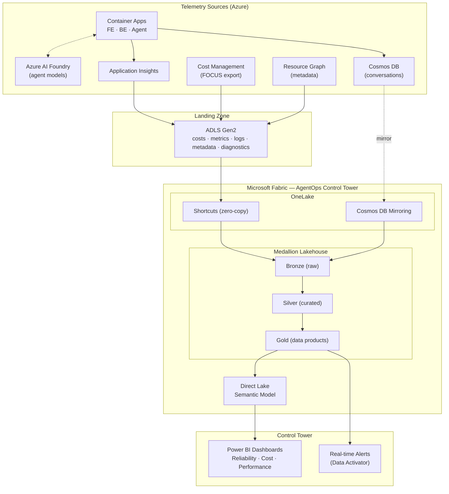

# Frontier Fabric AgentOps RVAS

Build a Microsoft Fabric control tower for **AI-agent reliability, cost, and performance**.
In this hands-on RVAS (Real Value Acceleration Solutions), your team ingests and correlates
telemetry from Azure services and Foundry-built agents, then builds dashboards and alerts.


Browse the challenges, coach guides, documentation, and reference files at
<https://microsoft.github.io/frontier-fabric-agentops-rvas/>. Use the
[delivery composer](https://microsoft.github.io/frontier-fabric-agentops-rvas/builder.html)
to select challenges for a customer's environment and export a delivery brief.

---

## The mission

Your customer runs **Azure AI Foundry** agents on **Azure Container Apps**, backed by **Cosmos DB**.
Leadership needs answers to three questions:

- **Reliability** — Which agents are healthy? Where are errors and latency spikes coming from?
- **Cost** — What is each agent costing us? Which team or use case owns that spend?
- **Performance** — Are we meeting SLAs? How many tokens are we using, and is usage increasing?

The telemetry exists, but it is scattered across Application Insights, Azure Monitor, Cost
Management, Resource Graph, and Cosmos DB. Your team will bring it together in an
**AgentOps Control Tower** on **Microsoft Fabric**: deploy the agent workload, land its telemetry,
connect it through OneLake shortcuts and Cosmos DB Mirroring, refine it through a medallion
architecture, and build dashboards.

Each challenge gives you a goal and success criteria. Your team chooses the implementation;
coaches help when you're blocked.

---

## What you'll build



The pipeline connects user activity, agent inference, and tool calls to OneLake and executive
dashboards. The stretch challenge adds live alerts. All components use Microsoft technology.

---

## RVAS format

| | |
|---|---|
| **Style** | Team-based (3–5 people), coach-facilitated, challenge-driven |
| **Level** | 200–400 (intermediate to advanced) |
| **Duration** | 1.5–2 days (7 challenges, ~1.5–2.5 hrs each; Challenge 6 is a stretch) |
| **Environment** | The **customer's own** Azure subscription(s) + a Microsoft Fabric capacity (**trial capacity is fine**) |
| **Roles** | Platform/Cloud engineer · Data engineer · FinOps practitioner · AI engineer (mix per team) |

Follow the challenge dependencies. Divide tasks within your team and regroup at each success checkpoint.

---

## The challenges

| # | Challenge | What you'll achieve | Primary skills |
|---|---|---|---|
| **0** | [Mission Briefing & Environment Setup](challenges/challenge-00-mission-setup.md) | Azure + Fabric trial capacity ready, tooling installed, team onboarded | Setup, Fabric admin |
| **1** | [Light Up the Agents](challenges/challenge-01-agent-telemetry.md) | Deploy the Foundry agent workload and confirm telemetry is flowing | Azure, Container Apps, App Insights |
| **2** | [Build the Telemetry Landing Zone](challenges/challenge-02-landing-zone.md) | Land cost, metrics, logs, metadata & diagnostics in ADLS Gen2 | Azure Monitor, FinOps, IaC |
| **3** | [Connect Fabric to the Enterprise](challenges/challenge-03-onelake-foundation.md) | Lakehouse + zero-copy OneLake shortcuts + Cosmos DB Mirroring | Fabric, OneLake |
| **4** | [Refine the Signal](challenges/challenge-04-medallion-pipeline.md) | Bronze→Silver→Gold medallion pipeline correlating all sources | PySpark, data engineering |
| **5** | [Stand Up the Control Tower](challenges/challenge-05-control-tower-dashboards.md) | Direct Lake semantic model + Reliability/Cost/Performance dashboards | Power BI, DAX, semantic modeling |
| **6** | [Make It Operational](challenges/challenge-06-operationalize.md) 🏆 | Stretch: real-time alerts, FinOps chargeback, RLS, automation | Data Activator, FinOps, governance |

See the [Challenge Index](challenges/README.md) for dependencies and scoring.

---

## Getting started

1. Read the [reference architecture](docs/architecture.md).
2. **Confirm prerequisites** — work through [`docs/prerequisites.md`](docs/prerequisites.md) with your coach **before day 1**. This covers Azure roles, Fabric trial capacity, and local tooling.
3. **Start with [Challenge 0](challenges/challenge-00-mission-setup.md).**
4. Keep the [FAQ](docs/faq.md) handy.

Coaches: start with the [Coach Handbook](coach/README.md). Each challenge has a guide with the
reference solution, key commands, common pitfalls, and talking points.

---

## Repository structure

```
frontier-fabric-agentops-rvas/
├── README.md                     ← you are here
├── docs/
│   ├── architecture.md           # Reference architecture & data flows
│   ├── prerequisites.md          # Azure + Fabric trial capacity + tooling setup
│   └── faq.md                    # Frequently asked questions
├── challenges/                   # 👩‍💻 Attendee-facing challenge guides (WHAT to build)
│   ├── README.md                 # Challenge index, dependencies, scoring
│   └── challenge-00 … 06.md
├── coach/                        # 🧑‍🏫 Instructor-facing guides (HOW it's done)
│   ├── README.md                 # Coach handbook: logistics, timing, facilitation
│   └── challenge-00 … 06-guide.md
└── resources/                    # 🧰 Provided reference assets (IaC, code, notebooks)
    ├── README.md
    ├── agent-workload/           # Foundry agent runtime (Container Apps, APIM, Cosmos DB)
    ├── observability-ingestion/  # ADLS Gen2 landing zone + export scripts
    ├── fabric-control-tower/     # Fabric workspace setup, medallion notebooks, pipelines, model
    └── observability-sdk/        # Shared Python SDK for agent telemetry
```

Use the reference implementation in `resources/` to deploy the Azure foundation and focus on
the Fabric Control Tower. Coaches decide when to share each challenge's reference solution.

---

## Outcomes

After this RVAS, your team will be able to:

- Deploy and instrument **Azure AI Foundry agents** that emit structured telemetry.
- Build a unified **observability landing zone** spanning telemetry, cost, and metadata.
- Read enterprise files through zero-copy **OneLake shortcuts** and replicate Cosmos DB data through **Mirroring**.
- Engineer a **medallion (Bronze/Silver/Gold)** lakehouse that correlates reliability, cost, and performance signals.
- Deliver **Direct Lake** Power BI dashboards and **real-time alerts** for an AgentOps Control Tower.
- Apply **FinOps** practices (FOCUS cost normalization, chargeback/showback) to AI workloads.

---

## Contributing

See [`CONTRIBUTING.md`](CONTRIBUTING.md) to propose improvements or add challenges.
Report bugs and request features through GitHub Issues.

## License

Licensed under the [MIT License](LICENSE).
